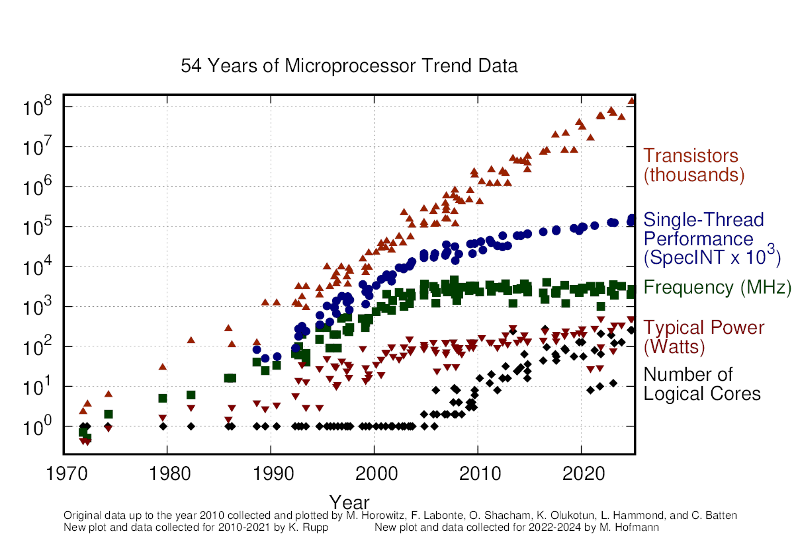

# Microprocessor Trend Data
matth2k: I have added some recent data through 2024.
This repository contains the raw data used in my blog series on microprocessor trend data:

  * 54 Years of Microprocessor Trend Data
    
  * [50 Years of Microprocessor Trend Data](https://www.karlrupp.net/2018/02/42-years-of-microprocessor-trend-data/)
  * [48 Years of Microprocessor Trend Data](https://www.karlrupp.net/2018/02/42-years-of-microprocessor-trend-data/)
  * [42 Years of Microprocessor Trend Data](https://www.karlrupp.net/2018/02/42-years-of-microprocessor-trend-data/)
  * [40 Years of Microprocessor Trend Data](https://www.karlrupp.net/2015/06/40-years-of-microprocessor-trend-data/)

### License

All raw data and my own plots are available under a Creative Commons Attribution 4.0 International Public License, see file [LICENSE.txt](LICENSE.txt) for details.
